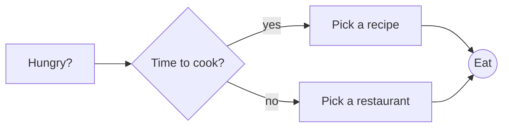
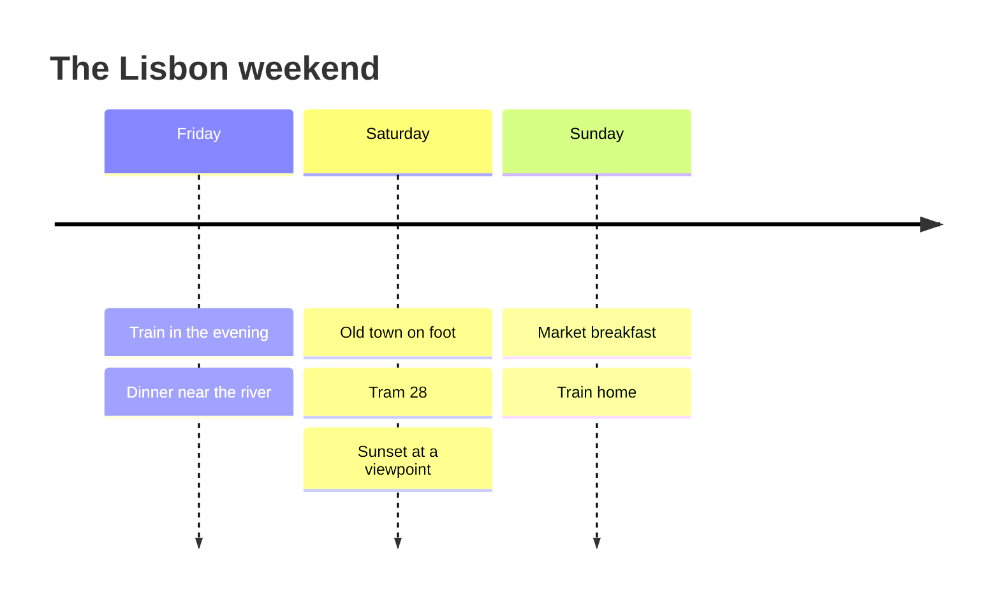
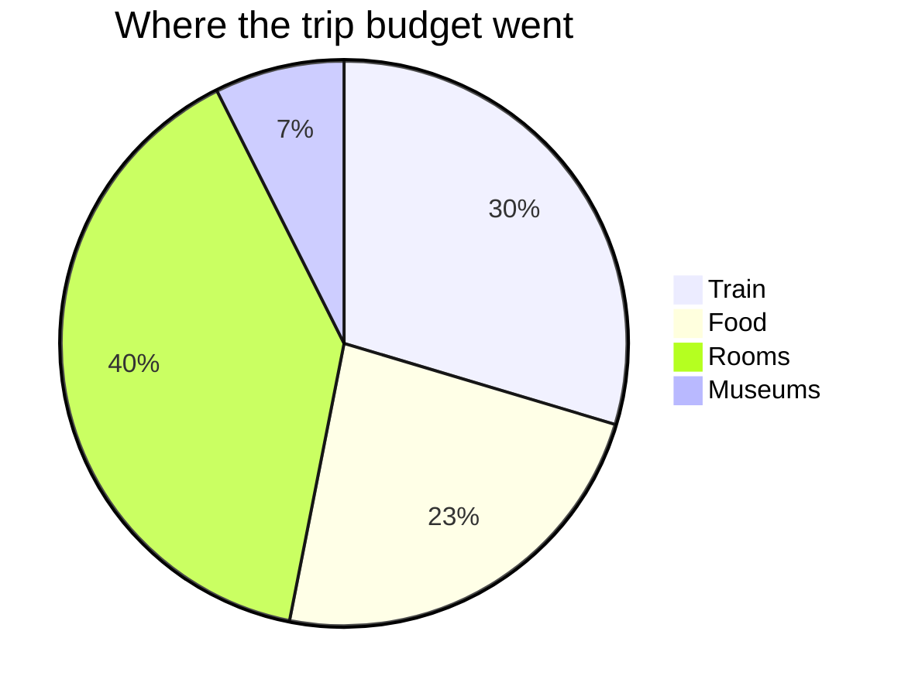
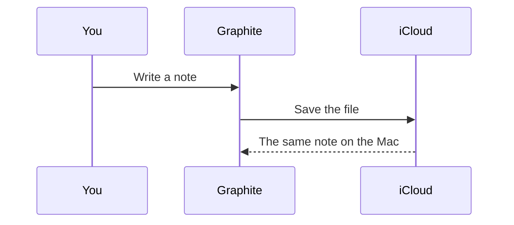
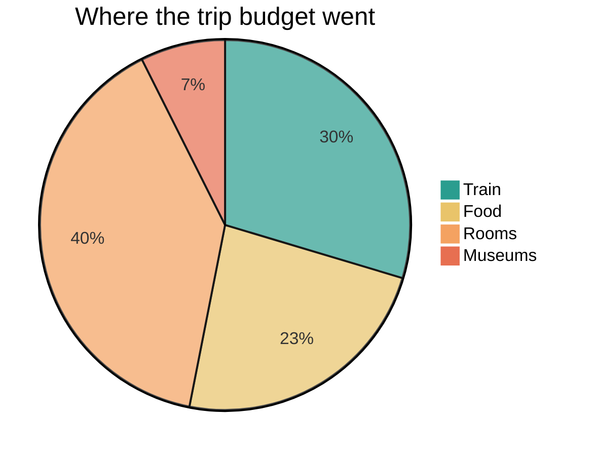

---
tags:
  - guide/markdown
---
# Diagrams

A diagram can be written as text, in Mermaid, and Graphite draws it. Change a word and the drawing follows.

## A flowchart

**Copy this**

````markdown

````

**What you see**


## A timeline



## A pie chart



## A sequence



Graphite also draws class, state, entity relationship and Gantt diagrams, mind maps, Git graphs, user journeys, quadrant charts, XY charts and Sankey diagrams. Write the source in a code block named `mermaid`, as above.

## Your own colours

A diagram can carry its own colours, as in Obsidian: list them under `config` › `themeVariables` at the top of the diagram, between two `---` lines.

**Copy this**

````markdown

````

**What you see**


The same colours can be given on one line before the diagram, `%%{init: {"themeVariables": {"pie1": "#2a9d8f"}}}%%`. These are the colours Graphite reads, the same ones Obsidian's diagrams read:

| Colours | What they colour |
| --- | --- |
| `pie1` to `pie8` | the slices of a pie chart |
| `git0` to `git7` | the branches of a Git graph |
| `cScale0` to `cScale7` | the periods of a timeline, the series of a radar chart, the groups of a treemap |
| `cScale1` to `cScale8` | the branches of a mind map |
| `venn1` to `venn8` | the circles of a Venn diagram |
| `plotColorPalette` under `xyChart` | the bars and lines of an XY chart, as one list: `"#2a9d8f, #e76f51"` |

Write each colour as `#` and its hex digits. Other theme variables, such as a chart's title colour, change nothing in Obsidian's diagrams, so they change nothing here either.

![[iPad - Diagram colours.jpg|460]]

*The pie chart above with its own colours, on iPad.*

## In a narrow column

A diagram wider than the column it is in is laid out again to fit it, as Obsidian lays it out: a flowchart, a timeline, a state, class or entity relationship diagram turns to run down the page, a pie chart's legend moves under the pie, a mind map becomes an outline and a user journey a column of cards. It happens by itself, in one side of a split, on an iPad held upright and on a phone. A diagram that still does not fit scrolls sideways.

![[iPad - Diagrams in a split, dark.jpg|460]]

*This note beside the course's lecture note on iPad, in the dark: the flowchart and the timeline turned to run down their side.*

## A theme's colours

A vault's Obsidian theme, or a CSS snippet, colours diagrams the way it does in Obsidian. Obsidian draws diagrams with its own colour variables, `--mermaid-color-1` to `--mermaid-color-8` for the series and `--mermaid-accent`, `--mermaid-line-color` and others for the rest, made from the theme's colours (`--color-blue` for the first series, `--interactive-accent` for the accent). Graphite reads the same variables, so a theme that changes them changes the diagrams in both apps. A diagram's own colours, above, still win.

This guide has a snippet to try, *Diagram colours*, switched off. Turn on **Use the Vault's Obsidian Theme** in Settings › Appearance, then, under **CSS Snippets**, **Diagram colours**: the timeline and the first pie chart in this note take its colours. The snippet is a few lines in `.obsidian/snippets`:

```css
body {
  --mermaid-color-1: #3d5a80;
  --mermaid-color-2: #ee6c4d;
  --mermaid-color-3: #98c1d9;
  --mermaid-color-4: #81b29a;
}
```

![[iPad - Diagram colours from a snippet.jpg|460]]

*The timeline and the first pie chart with the snippet turned on, on iPad.*

See [[Themes and snippets]] for more on snippets.

## On iPad and the Mac

![[iPad - Diagrams.jpg|380]] ![[Mac - Diagrams.jpg|560]]

*This note in the reading view: on iPad in the dark, on the Mac in the light.*
