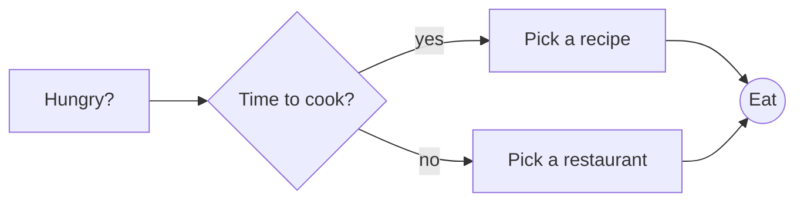
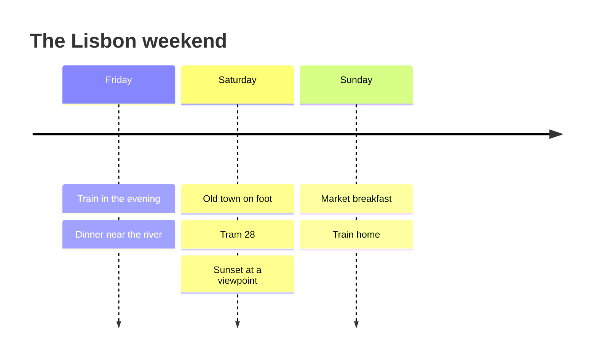
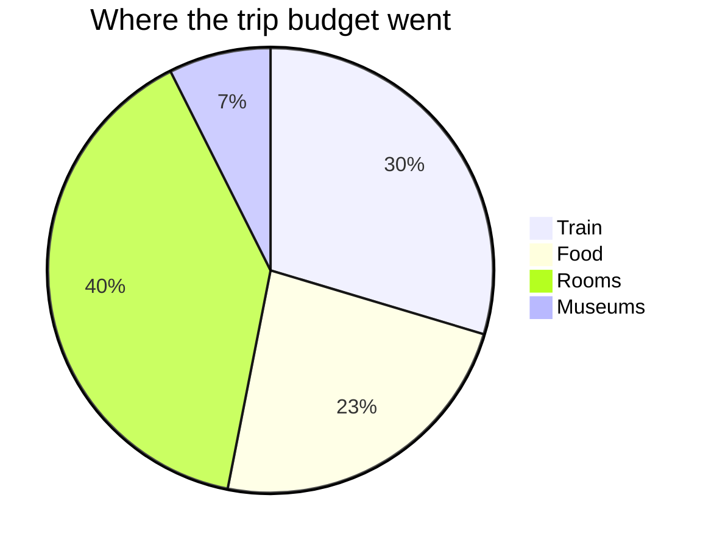
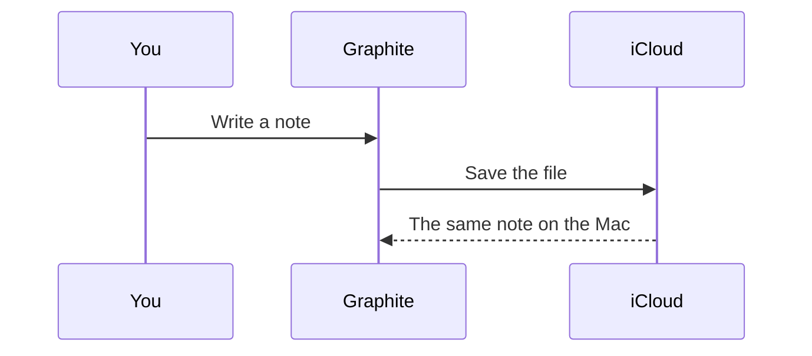

---
tags:
  - guide/markdown
---
# Diagrams

A diagram can be written as text, in Mermaid, and Graphite draws it. Change a word and the drawing follows.

## A flowchart

**Copy this**

````markdown

````

**What you see**


## A timeline



## A pie chart



## A sequence



Graphite also draws class, state, entity relationship and Gantt diagrams, mind maps, Git graphs, user journeys, quadrant charts, XY charts and Sankey diagrams. Write the source in a code block named `mermaid`, as above.
