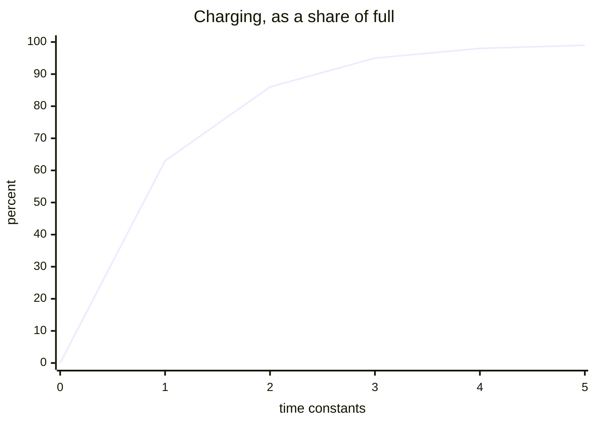

# Week 2: Capacitors

A capacitor stores charge, like a small bucket for electricity. With a resistor in front of it, it fills slowly: that is how a camera flash charges and why a light can fade out gently.

## The RC circuit

Drawn in class with Apple Pencil, inside this note:

![[Circuit drawing.png|460]]

Tap the drawing's **Edit** button to change it stroke by stroke. See [[Drawings in notes]].

## How fast it fills

The time constant is $\tau = R C$. After one $\tau$ the capacitor is about 63 % full; after five it is practically full:

$$
v(t) = V_0 \left(1 - e^{-t/\tau}\right)
$$

## Questions for next time

- [ ] Why does a bigger capacitor take longer to fill?
- [ ] What happens if $R$ is halved?

Back to [[Everyday Electronics]], or the slides from [[Week 1 - Voltage and current|week 1]].
