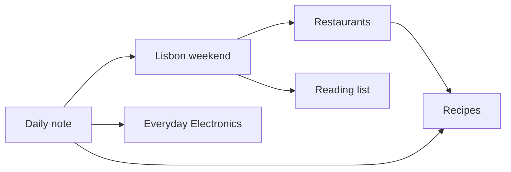

---
tags:
  - guide/examples
---
# Everyday examples

These folders show the kinds of things people keep in a vault, all made up for this guide. Each one links to the others, so you can see how a vault grows into something you can walk through.

| Example | What it shows | Start at |
| --- | --- | --- |
| Recipes | properties, pictures, tasks as a shopping list, a gallery base | [[Recipes]] |
| Restaurants | places on a map, ratings, a base sorted by rating | [[Restaurants]] |
| A course | lecture notes with slides, formulas, a drawing and a notebook | [[Everyday Electronics]] |
| A trip | a plan with tasks, a timeline, a map and links to restaurants | [[Lisbon weekend]] |
| A reading list | book covers, a status for each book, three views of one base | [[Reading list]] |
| A day | a daily note that ties the others together | [[2026-11-16]] |

## How they connect

Open the graph (⇧⌘G) to see the same thing drawn from the links themselves.

> [!tip] Make them yours
> Change anything here: add a recipe you love, rate a restaurant, tick a task. This is your copy of the guide. Then make your own vault and start one of these for real.
