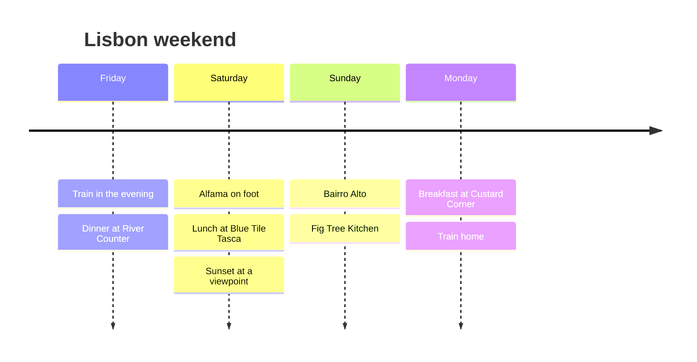

# Lisbon weekend

![[Lisbon weekend.png]]

Three days of hills, trams and long lunches. The places we ate are in [[Restaurants]]; two of them gave us recipes to cook at home.

## Before we go

- [x] Book the train
- [x] Book two nights near the river
- [ ] Download the tram map
- [ ] Pack a book from the [[Reading list]]: [[Maps of Small Places]]

## The plan

| Day | Where we eat | |
| --- | --- | --- |
| Friday | [[River Counter]] | seafood by the river |
| Saturday | [[Blue Tile Tasca]] | book ahead |
| Sunday | [[Fig Tree Kitchen]], [[Green Door Café]] | lunch and dinner |
| Monday | [[Custard Corner]] | before the train |

## On the map

![[Restaurants.base#Map]]

## What it cost

| | € |
| --- | ---: |
| Train | 120 |
| Rooms | 160 |
| Food | 95 |
| Museums | 30 |
| **Total** | **405** |

> [!success] Back home
> Cooked the [[Tomato soup]] the week after. Close enough.
