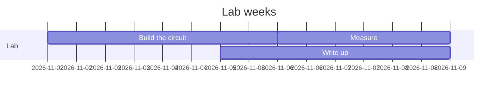
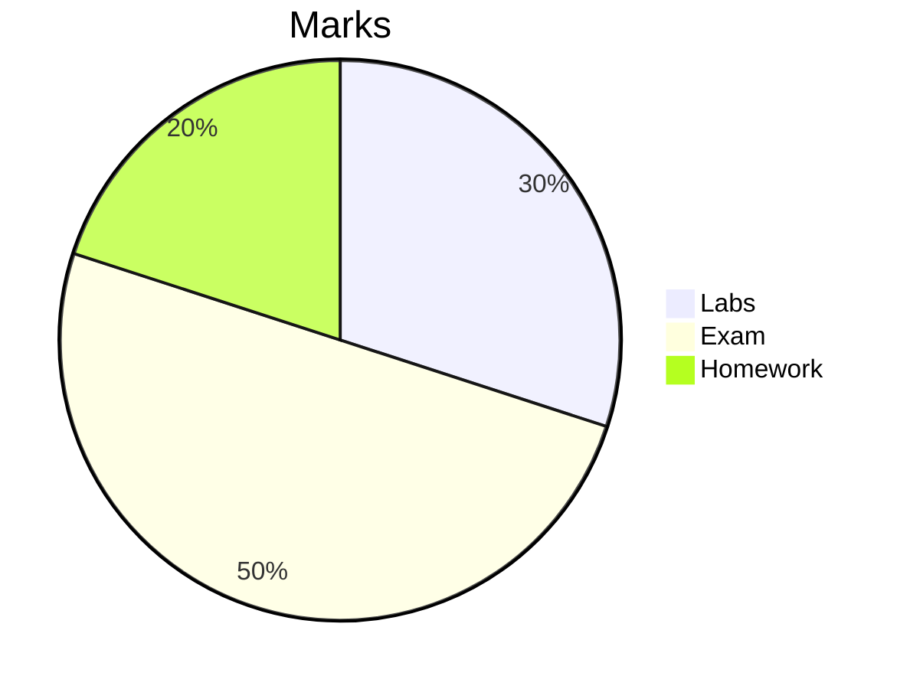
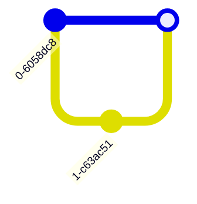

# Diagram options

Mermaid diagrams with the options Graphite reads, and one Graphite cannot draw.

## A compact Gantt chart



## A pie chart with its labels outside, a hole and a legend on the right



## A git graph, its branch line hidden



## An empty diagram

Graphite shows its source and why it is not drawn:

```mermaid
```
