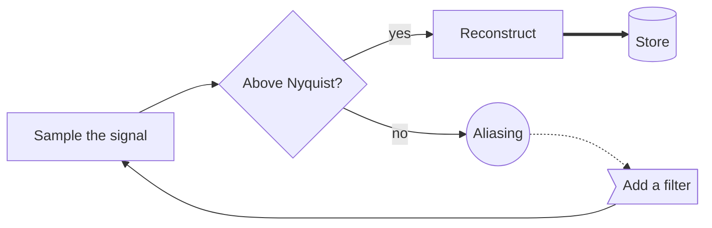
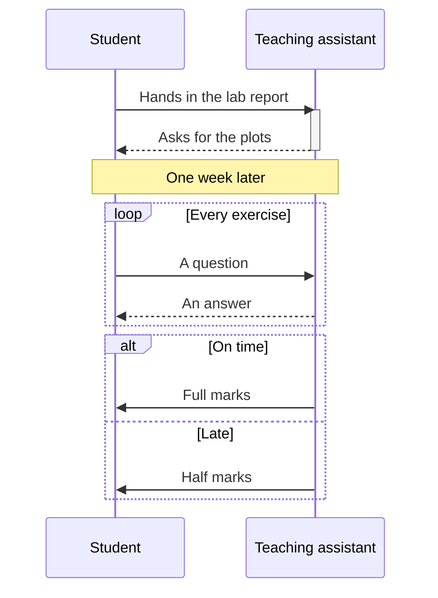

# Flowcharts and sequences

## Flowchart



## Graph, top down, with subgraphs

```mermaid
graph TD
    subgraph Front end
        M[Microphone] --> P[Preamplifier]
    end
    subgraph Converter
        P --> S[Sample and hold] --> Q[Quantizer]
    end
    Q --> O[Output]
```

## Sequence diagram


